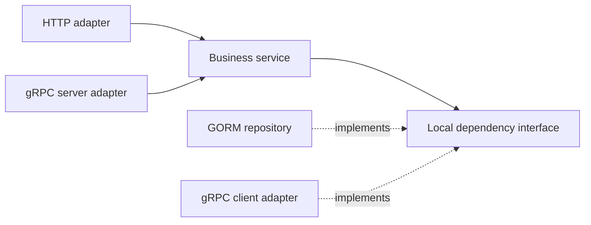

goNex uses explicit registration and ordinary Go composition. Its business core is independent of HTTP, RPC and persistence adapters.

## Dependency direction

Business services live in `modules/NAME/service.go` and use plain Go values plus small interfaces owned by the consumer. HTTP adapters own schemas and request mapping; GORM repositories and gRPC clients implement business interfaces at their boundaries. Services should not import Gin, GORM, gRPC, Protobuf or transport DTOs.

## Registration and lifecycle

A module receives registration capabilities, never ownership of a listener. Registration is explicit, ordered and atomic per App.Register call. The application owns listeners and managed resources. Startup failures close started resources; shutdown drains HTTP and closes resources in reverse order. Stopped applications cannot restart.

Dependencies register before consumers. Context-aware resource lifecycles make background work and cleanup explicit. See [modules and lifecycle](/docs/main/modules/).

## HTTP and RPC boundaries

HTTP is unversioned by default. OpenAPI projects the registered typed endpoints. Independent versioned HTTP adapters can share one core service; legacy routes remain unless replacement is explicit.

gRPC is opt-in and has no default listener. Protobuf packages and Go paths carry their API major. Contracts use a separate Go module so services can depend on a shared wire contract without importing each other's business code.

## Generator ownership

Generators own marked registries and record hashes in `.gonex.json`. They plan and validate writes first, reject handwritten destination collisions and support dry runs. Runtime composition does not scan source or depend on a dependency-injection container.

Independent services have their own Go modules, configuration and migrations. A local go.work file is a development convenience; production dependencies must resolve independently.

## Dependencies

The framework is not dependency-free. The root go.mod declares **10 direct dependencies**; indirect dependencies are recorded separately in go.mod and go.sum. Optional integrations share the module dependency graph, but HTTP-only applications need not import or start database/RPC adapters.

| Direct dependency | Responsibility |
|---|---|
| `github.com/gin-gonic/gin` | HTTP routing and middleware |
| `github.com/go-playground/validator/v10` | Typed input validation |
| `github.com/santhosh-tekuri/jsonschema/v6` | Offline OpenAPI schema validation |
| `github.com/ncruces/go-sqlite3/gormlite` | CGO-free SQLite integration |
| `gorm.io/driver/postgres` | PostgreSQL driver |
| `gorm.io/gorm` | Optional persistence adapter |
| `google.golang.org/grpc` | Optional RPC transport |
| `google.golang.org/protobuf` | Protobuf runtime and generation support |
| `github.com/bufbuild/protocompile` | Contract compilation tooling |
| `golang.org/x/mod` | Go module validation and generator edits |

The list above groups responsibilities; the actual source of truth is [go.mod](https://github.com/amkargar/gonex/blob/main/go.mod), including any separate module requirements. Check its first require block when updating the dependency badge.

## Design decisions and limits

Prefer small consumer-owned interfaces and explicit constructors over global registries. Keep validation and the exported contract coherent, rather than silently projecting unsupported DTO behavior. Keep migrations explicit and immutable.

Service discovery is static, cancellation is cooperative and generators do not invent business mappings. See [API decisions](/docs/main/api-reference/), [upgrade policy](/docs/main/upgrades/) and [release scope](/docs/main/release/).
